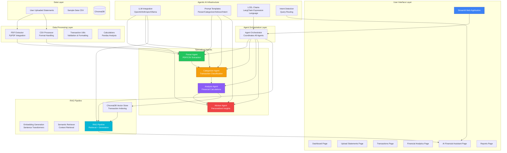
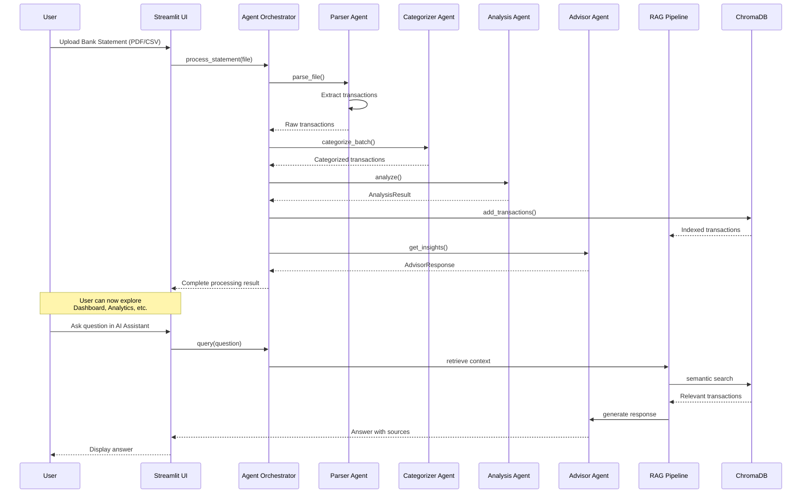

# FinanceIQ - Statement-to-Insights Finance Agent

> An AI-powered personal finance analysis application that transforms bank statements into actionable financial insights.

[](https://python.org)
[](https://streamlit.io)
[](https://langchain.com)
[](LICENSE)

---

## 📋 Table of Contents

1. [Project Overview](#project-overview)
2. [Problem Statement](#problem-statement)
3. [Objectives](#objectives)
4. [System Architecture](#system-architecture)
5. [Agent Descriptions](#agent-descriptions)
6. [Technology Stack](#technology-stack)
7. [Installation](#installation)
8. [Environment Setup](#environment-setup)
9. [Running the Application](#running-the-application)
10. [Sample Data](#sample-data)
11. [Testing](#testing)
12. [Limitations & Future Enhancements](#limitations--future-enhancements)
13. [Project Structure](#project-structure)

---

## Project Overview

**FinanceIQ** is an intelligent, agentic AI application designed to help individuals analyze their personal finances by:

- Extracting transactions from PDF and CSV bank statements
- Automatically categorizing expenses using rule-based and LLM-powered classification
- Performing comprehensive financial analysis using Pandas
- Generating personalized, evidence-based financial insights
- Enabling natural language queries about financial data through an AI assistant

The application demonstrates a complete **Agentic AI architecture** with four specialized agents working in coordination, implemented using LangChain, LCEL (LangChain Expression Language), ChromaDB for vector storage, and RAG (Retrieval-Augmented Generation) for context-grounded responses.

---

## Problem Statement

Personal finance management remains a challenge for many individuals because:

1. **Manual analysis is tedious** - Reviewing bank statements manually to understand spending patterns is time-consuming
2. **Banking portals provide limited insights** - Most banks only show transaction lists without meaningful analysis
3. **Categorization is manual** - Users have to manually tag transactions to understand where money goes
4. **No personalized guidance** - Generic financial advice doesn't account for individual spending patterns
5. **Difficulty tracking trends** - Month-over-month comparisons require manual calculations

**FinanceIQ addresses these problems** by automating transaction extraction, categorization, analysis, and providing AI-powered personalized insights based on actual user data.

---

## Objectives

### Primary Objectives
1. **Automated Statement Processing** - Extract transactions from PDF and CSV bank statements
2. **Intelligent Categorization** - Classify transactions into meaningful categories using hybrid rule-based and LLM approaches
3. **Comprehensive Analysis** - Calculate income, expenses, savings, and identify spending patterns
4. **Personalized Insights** - Generate evidence-backed financial recommendations based on actual data
5. **Natural Language Interface** - Enable users to ask questions about their finances in plain English

### Agentic AI Objectives
1. Implement four specialized AI agents with distinct responsibilities
2. Use LangChain and LCEL for agent orchestration
3. Implement Agentic RAG for context-grounded responses
4. Use ChromaDB for vector storage and semantic search
5. Demonstrate intent detection and intelligent query routing

---

## System Architecture

### Architecture Diagram



### Data Flow Diagram



---

## Agent Descriptions

### Agent 1: Statement Parser Agent

**Responsibility:** Extract transaction data from bank statements

**Capabilities:**
- PDF statement extraction using PyPDF
- CSV statement processing with flexible column mapping
- Date format normalization (multiple formats supported)
- Amount parsing (handles currency symbols, parentheses for negatives)
- Transaction validation and deduplication
- Error handling for invalid/malformed statements

**Input:** PDF or CSV bank statement files
**Output:** Structured list of transactions with date, description, debit, credit, amount

### Agent 2: Transaction Categorization Agent

**Responsibility:** Classify transactions into spending categories

**Categories Supported:**
- Food and Dining, Shopping, Transportation, Groceries
- Entertainment, Healthcare, Education, Bills and Utilities
- Rent, Travel, Salary and Income, Transfers, Other

**Classification Methods:**
1. **Rule-based (Primary):** Keyword matching against 100+ predefined keywords per category
2. **LLM-based (Optional):** When rules are uncertain, LLM analyzes context for better classification
3. **User Corrections:** Users can manually correct categories

**Input:** List of transactions
**Output:** Transactions with assigned categories and confidence scores

### Agent 3: Financial Analysis Agent

**Responsibility:** Perform comprehensive financial calculations

**Calculations:**
- Total income, total expenses, net savings
- Monthly breakdown (income, expenses, savings per month)
- Category-wise expenditure breakdown
- Highest spending category identification
- Average daily expenditure
- Monthly savings rate
- Month-over-month spending changes
- Unusual transaction detection (statistical outlier analysis)

**Key Principle:** Uses Pandas for all numerical calculations - never allows LLM to invent financial figures

**Input:** Categorized transactions DataFrame
**Output:** AnalysisResult with all calculated metrics

### Agent 4: Financial Advisor Agent

**Responsibility:** Generate personalized, evidence-based financial insights

**Capabilities:**
- Analyze user's actual spending patterns
- Identify overspending categories
- Compare current vs previous months
- Suggest practical budgeting improvements
- Recommend achievable savings targets
- Answer specific questions about the uploaded statement

**Grounding Principle:** All recommendations are based on uploaded data - never presents educational suggestions as guaranteed advice

**Input:** Analysis results + user question (optional)
**Output:** Personalized insights, suggestions, and answers

---

## Technology Stack

| Component | Technology | Purpose |
|-----------|------------|---------|
| **Language** | Python 3.8+ | Primary programming language |
| **Web Interface** | Streamlit | Interactive web application framework |
| **LLM Orchestration** | LangChain | LLM integration and chain management |
| **Expression Language** | LCEL | Composable chain construction |
| **Vector Database** | ChromaDB | Semantic search and document storage |
| **Embeddings** | Sentence Transformers | Text embedding generation |
| **Data Processing** | Pandas | Transaction processing and calculations |
| **Visualization** | Plotly | Interactive charts and graphs |
| **PDF Processing** | PyPDF | PDF statement extraction |
| **Environment** | Python-dotenv | Environment variable management |

### LLM Providers Supported
- **OpenAI** (GPT-4, GPT-4o, GPT-3.5-turbo)
- **Anthropic** (Claude)
- **Ollama** (Local models)
- **Mock Mode** (Demo without API key)

---

## Installation

### Prerequisites
- Python 3.8 or higher
- pip (Python package installer)
- Git (optional, for cloning)

### Step 1: Clone or Download

```bash
# If using git
git clone <repository-url>
cd FinanceIQ

# Or download and extract
cd FinanceIQ
```

### Step 2: Create Virtual Environment (Recommended)

```bash
python -m venv venv

# On Windows
venv\Scripts\activate

# On macOS/Linux
source venv/bin/activate
```

### Step 3: Install Dependencies

```bash
pip install -r requirements.txt
```

This installs:
- `streamlit` - Web application framework
- `langchain` + `langchain-core` + `langchain-community` - LLM orchestration
- `chromadb` - Vector database
- `sentence-transformers` - Embedding model
- `pandas` - Data processing
- `pypdf` - PDF extraction
- `plotly` - Interactive visualizations
- `python-dotenv` - Environment management

### Step 4: Download Embedding Model (First Run)

The first time you run the application, it will automatically download the sentence-transformers model (~90MB). This may take a few minutes depending on your internet connection.

---

## Environment Setup

### 1. Copy Environment Template

```bash
# Windows
copy .env.example .env

# macOS/Linux
cp .env.example .env
```

### 2. Configure Environment Variables

Edit the `.env` file:

```env
# OpenAI Configuration (Recommended)
OPENAI_API_KEY=sk-your-api-key-here
OPENAI_MODEL_NAME=gpt-4o-mini

# Or Anthropic (Alternative)
# ANTHROPIC_API_KEY=your-anthropic-key
# ANTHROPIC_MODEL_NAME=claude-3-haiku-20240307

# LLM Settings
LLM_PROVIDER=openai
LLM_MODEL=gpt-4o-mini
LLM_TEMPERATURE=0.7
LLM_MAX_TOKENS=2048

# Application
ENVIRONMENT=development
DEBUG=false
```

### Getting API Keys

**OpenAI:**
1. Visit https://platform.openai.com/api-keys
2. Create an account if needed
3. Generate a new API key
4. Copy the key to your `.env` file

**Demo Mode:**
If you don't have an API key, the application will work in demo mode with rule-based features and mock LLM responses. All financial calculations will work correctly.

---

## Running the Application

### Start the Application

```bash
streamlit run app.py
```

### Access the Application

Open your browser and navigate to:
```
http://localhost:8501
```

### Expected Workflow

1. **Upload Statements** - Upload a PDF or CSV bank statement
2. **Dashboard** - View your financial summary and charts
3. **Transactions** - Browse and filter transactions, edit categories
4. **Financial Analytics** - Explore detailed analytics and charts
5. **AI Financial Assistant** - Ask questions about your finances
6. **Reports** - Generate and download financial reports

### Running with Sample Data

The application includes sample data. On the Upload page, click **"Load Sample Transactions"** to try FinanceIQ without uploading your own statements.

---

## Sample Data

A sample CSV bank statement (`data/sample_transactions.csv`) is included with 42 transactions
spanning January-March 2025: three salary credits, everyday expenses across food, shopping,
transport, bills, healthcare, travel and entertainment, plus a running balance.

### Required CSV format

FinanceIQ reads a header row plus one transaction per row. Column names are detected
case-insensitively, so `Date`/`date`, `Narration`/`Description`, `Withdrawal`/`Debit`
and `Deposit`/`Credit` all work.

| Column | Required | Notes |
|--------|----------|-------|
| `Date` | Yes | `YYYY-MM-DD`, `DD/MM/YYYY`, `DD-MM-YYYY` or `MM/DD/YYYY` |
| `Description` | Yes | Merchant / narration text, used for categorization and search |
| `Debit` | Yes* | Money going out (leave empty for income rows) |
| `Credit` | Yes* | Money coming in (leave empty for expense rows) |
| `Balance` | No | Running balance, shown but not used in totals |
| `Amount` | Yes* | Signed amount, only if `Debit`/`Credit` columns are absent |

\* Provide either the `Debit` + `Credit` pair or a single `Amount` column. FinanceIQ
reports income from credits and expenses from debits, so a `Debit`/`Credit` pair gives the
most accurate dashboard.

Example (`data/sample_transactions.csv`):

```csv
Date,Description,Debit,Credit,Balance
2025-01-01,Salary Credit - ABC Corp,,50000.00,50000.00
2025-01-05,SWIGGY - Food Delivery,890.00,,47610.00
```

To use sample data:
1. Start the application
2. Go to **Upload Statements** page
3. Click **"Load Sample Transactions"**

The same file can be uploaded through the CSV uploader, or downloaded from the
**Reports** page after processing.

---

## Testing

### Manual Testing Checklist

1. **PDF Upload**
   - [ ] Upload a PDF bank statement
   - [ ] Verify transactions are extracted
   - [ ] Check date parsing and amount extraction

2. **CSV Upload**
   - [ ] Upload a CSV bank statement
   - [ ] Verify column detection works
   - [ ] Check transaction extraction

3. **Categorization**
   - [ ] Verify transactions are categorized
   - [ ] Check rule-based classification
   - [ ] Test manual category editing

4. **Dashboard**
   - [ ] Verify metrics display correctly
   - [ ] Check charts render properly
   - [ ] Verify recent transactions show

5. **Analytics**
   - [ ] Check monthly breakdown
   - [ ] Verify category analysis
   - [ ] Check month-over-month comparisons

6. **AI Assistant**
   - [ ] Ask spending questions
   - [ ] Ask category questions
   - [ ] Test monthly comparisons
   - [ ] Test budget recommendations

7. **Reports**
   - [ ] Generate financial summary
   - [ ] Test CSV export
   - [ ] Test JSON export

### Sample Test Commands

```bash
# Test CSV processing
python -c "
from utils.csv_processor import process_csv_transactions
import pandas as pd

df = pd.read_csv('data/sample_transactions.csv')
result = process_csv_transactions(df.to_csv(index=False).encode())
print(f'Extracted {len(result)} transactions')
print(result.head())
"

# Test calculations
python -c "
from utils.calculations import (
    calculate_total_income,
    calculate_total_expenses,
    calculate_net_savings
)
import pandas as pd

df = pd.read_csv('data/sample_transactions.csv')
print(f'Total Income: ₹{calculate_total_income(df):,.2f}')
print(f'Total Expenses: ₹{calculate_total_expenses(df):,.2f}')
print(f'Net Savings: ₹{calculate_net_savings(df):,.2f}')
"

# Test categorization
python -c "
from agents.categorizer_agent import CategorizerAgent
agent = CategorizerAgent()
categories = agent.apply_rule_based_categories([
    {'description': 'Swiggy Food Order', 'amount': 500, 'debit': 500, 'credit': 0},
    {'description': 'Amazon Purchase', 'amount': 2000, 'debit': 2000, 'credit': 0},
    {'description': 'Salary Credit', 'amount': 50000, 'debit': 0, 'credit': 50000},
])
for t in categories:
    print(f\"{t['description']}: {t['category']} ({t['category_source']})\")
"
```

---

## Limitations & Future Enhancements

### Current Limitations

1. **PDF Extraction Quality**
   - PDF extraction depends on the PDF structure
   - Some complex table layouts may not extract perfectly
   - Handled PDFs with standard text extraction

2. **CSV Format Variations**
   - Different banks use different column names
   - Some formats may require manual column mapping

3. **LLM Dependency**
   - Advanced AI features require API keys
   - Demo mode has limited conversational capabilities
   - LLM responses may occasionally be generic

4. **Language Support**
   - Currently optimized for English transaction descriptions
   - Indian bank statements work best (₹ currency, common Indian merchants)

5. **Data Privacy**
   - Data stored locally only (in-memory and ChromaDB)
   - No cloud synchronization
   - User must manually clear data

### Future Enhancements

1. **Enhanced PDF Support**
   - Table extraction using specialized libraries
   - Multi-column PDF support
   - Image-based PDF (OCR) support

2. **Bank Integration**
   - Official bank APIs where available
   - OFX/QIF format support

3. **Advanced Analytics**
   - Budget forecasting
   - Recurring expense detection
   - Anomaly/fraud detection

4. **Multi-Language Support**
   - Non-English transaction descriptions
   - Multi-currency support

5. **Collaborative Features**
   - Family finance sharing (with privacy controls)
   - Export to accounting software formats

6. **Mobile Application**
   - React Native or Flutter mobile app
   - Camera-based statement scanning

---

## Project Structure

```
FinanceIQ/
│
├── app.py                    # Main Streamlit application
├── config.py                 # Configuration settings
├── requirements.txt          # Python dependencies
├── .env.example              # Environment template
├── README.md                 # This file
│
├── agents/                   # AI Agent modules
│   ├── parser_agent.py       # Statement parsing agent
│   ├── categorizer_agent.py  # Transaction categorization agent
│   ├── analysis_agent.py     # Financial analysis agent
│   ├── advisor_agent.py      # Financial advisor agent
│   └── orchestrator.py       # Agent coordination
│
├── rag/                      # RAG pipeline modules
│   ├── embeddings.py         # Embedding generation
│   ├── vector_store.py       # ChromaDB vector store
│   ├── retriever.py          # Semantic retrieval
│   └── rag_pipeline.py       # End-to-end RAG pipeline
│
├── utils/                    # Utility modules
│   ├── pdf_extractor.py      # PDF extraction
│   ├── csv_processor.py      # CSV processing
│   ├── transaction_utils.py  # Transaction utilities
│   └── calculations.py       # Financial calculations
│
├── prompts/                  # Prompt templates
│   ├── parser_prompt.py      # Parser agent prompts
│   ├── categorizer_prompt.py # Categorizer prompts
│   ├── advisor_prompt.py     # Advisor prompts
│   └── intent_prompt.py      # Intent detection prompts
│
├── data/                     # Data files
│   ├── sample_transactions.csv  # Sample bank statement
│   └── .gitkeep
│
├── tests/                    # Test files
│   ├── test_parser.py
│   ├── test_categorizer.py
│   └── test_analysis.py
│
└── llm_client.py            # LLM client (OpenAI/Anthropic/Ollama)
```

---

## Key Features Summary

✅ **Four Specialized Agents** - Parser, Categorizer, Analyzer, Advisor
✅ **LangChain & LCEL** - Modern LLM orchestration
✅ **Agentic RAG** - Context-grounded financial Q&A
✅ **ChromaDB Integration** - Semantic search over transactions
✅ **Intent Detection** - Smart query routing
✅ **Interactive Dashboard** - Beautiful fintech UI
✅ **Interactive Charts** - Plotly visualizations
✅ **Multiple File Formats** - PDF and CSV support
✅ **Category Management** - Rule-based + LLM classification
✅ **Export Options** - CSV, JSON, text reports
✅ **Privacy-First** - Local data storage, no cloud sync
✅ **Demo Mode** - Works without API keys
✅ **Sample Data** - Test without personal data

---

## License

MIT License - Feel free to use for personal and educational purposes.

---

## Support

For issues, questions, or contributions:
1. Check this README first
2. Review the code documentation
3. Test with sample data first
4. Ensure environment is configured correctly

---

*Built with ❤️ for Agentic AI Education*
